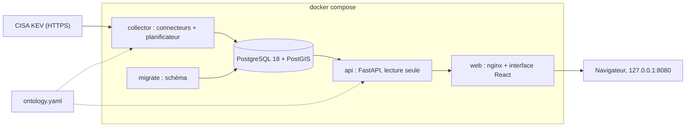

# Estran

**Là où Internet touche terre.**

L'estran, c'est la bande de côte que la mer découvre à marée basse — là où les câbles
sous-marins sortent de l'eau. Estran est une plateforme locale qui branche des sources de
données ouvertes et en fait **un seul monde d'objets reliés entre eux**, où chaque information
garde la trace de sa source et de sa licence.

> État : **phase 0a** (socle fonctionnel). Une source branchée, le catalogue CISA KEV des
> vulnérabilités dont l'exploitation est avérée. La [feuille de route](#feuille-de-route) dit
> ce qui vient ensuite.

## Démarrage

Prérequis : [Docker Desktop](https://www.docker.com/products/docker-desktop/) lancé.

```bash
docker compose up -d --build
```

Puis ouvrir <http://127.0.0.1:8080>. Au premier lancement, compter une à deux minutes de
construction ; la première collecte suit en quelques secondes.

| Pour… | Commande |
|---|---|
| voir l'état des services | `docker compose ps` |
| relancer la collecte à la main | `docker compose exec collector python -m estran.collector run kev` |
| travailler sans Internet | `ESTRAN_MODE=snapshot` dans `.env` (voir `.env.example`) |
| lancer les tests du serveur | `docker compose -f compose.test.yaml run --rm tests` |
| lancer les tests de l'interface | `docker compose -f compose.test.yaml run --rm web-tests` |
| tout arrêter | `docker compose down` (ajouter `-v` pour effacer la base) |

## Ce qu'on y voit

- **Accueil** — les trois couches de l'ontologie (Territoire, Infrastructure, Menace). Celles
  qui n'ont pas encore de données sont « sous l'eau ».
- **Listes** — vulnérabilités, produits, éditeurs : recherche, tri, filtre.
- **Fiche d'un objet** — ses propriétés, ses liens vers d'autres objets, et en marge sa
  **provenance** : quelle source, quelle licence, relevée quand.
- **Sources** — l'état de chaque collecte.

## Les idées derrière

**L'ontologie est du code.** [`ontology/ontology.yaml`](ontology/ontology.yaml) décrit les
types d'objets, leurs propriétés et leurs liens. La base, l'API et l'interface en découlent :
les colonnes d'une liste, les libellés, les filtres ne sont écrits nulle part ailleurs.

**Brancher une source, c'est la traduire.** Un connecteur est un dossier : un `manifest.yaml`
(adresse, licence, cadence) et une fonction `translate` qui transforme le document brut en
objets et en liens. Tout ce qui ne respecte pas l'ontologie est refusé avant la base.

**La provenance n'est pas une option.** Chaque objet et chaque lien sait quelle source l'a
fourni et quand. Un lien porte aussi sa *nature* — fait ou hypothèse — pour ne jamais présenter
une déduction comme une donnée.

**Aucune donnée personnelle, par construction.** Estran analyse des événements, des
infrastructures, des organisations et des territoires. Un schéma qui décrirait une personne
(`person`, `email`, `téléphone`…) est refusé au chargement, et un test le prouve.

**Les licences sont vérifiées par le programme.** Une source non redistribuable ne peut pas
avoir d'instantané embarqué. Détail des sources : [`docs/sources.md`](docs/sources.md).

## Architecture



Seul le port de l'interface est publié, et seulement sur `127.0.0.1`. Plus de détails :
[`docs/architecture.md`](docs/architecture.md).

| Brique | Choix |
|---|---|
| Stockage | PostgreSQL 18 + PostGIS : un modèle générique `objects` / `links` / `provenance` |
| Collecte et API | Python 3.14, FastAPI, SQLAlchemy, Alembic, `uv` |
| Interface | React 19, Vite, TypeScript ; polices embarquées, aucune requête vers l'extérieur |

## Feuille de route

| | Phase | Contenu |
|---|---|---|
| fait | 0a — Socle | Ontologie, base, connecteur KEV, API, interface |
| | 0b — Durcissement | Réseaux cloisonnés, proxy sortant à liste blanche, conteneurs en lecture seule, scans |
| | 1 — Couche Menace | CVE, EPSS, MITRE ATT&CK, CERT-FR, abuse.ch ; explorateur de graphe |
| | 2 — Mon parc | Croiser l'inventaire d'un lab avec les vulnérabilités exploitées |
| | Bonus | Territoire et Infrastructure (carte, câbles, pannes), enquêtes, assistant local |

## Limites connues

- Pas de cloisonnement réseau ni de proxy sortant avant la phase 0b.
- Une seule source : les objets ne sont reliés qu'entre vulnérabilités, produits et éditeurs.
- Deux produits dont les noms ne diffèrent que par la ponctuation sont fusionnés.

## Licence

Code sous licence [MIT](LICENSE). Les données gardent la licence de leur source.
