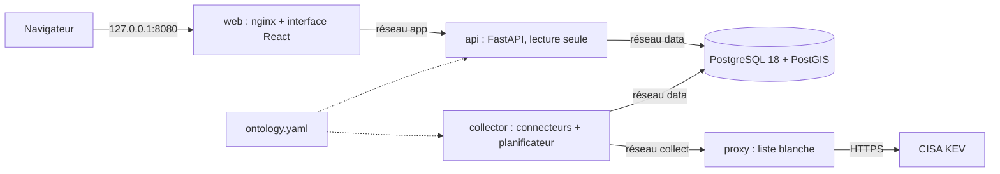

# Estran

**Là où Internet touche terre.**

L'estran, c'est la bande de côte que la mer découvre à marée basse — là où les câbles
sous-marins sortent de l'eau. Estran est une plateforme locale qui branche des sources de
données ouvertes et en fait **un seul monde d'objets reliés entre eux**, où chaque information
garde la trace de sa source et de sa licence.

> État : **phase 1a** (couche Menace). Six sources ouvertes branchées : failles exploitées
> (CISA KEV), gravité (NVD) et probabilité d'exploitation (EPSS), techniques et groupes
> d'attaquants (MITRE ATT&CK), alertes du CERT-FR. La [feuille de route](#feuille-de-route)
> dit ce qui vient ensuite.

## Démarrage

Prérequis : [Docker Desktop](https://www.docker.com/products/docker-desktop/) lancé.

```bash
docker compose up -d --build
```

Puis ouvrir <http://127.0.0.1:8080>. Au premier lancement, compter quelques minutes de
construction ; la première collecte suit en quelques secondes. Aucun mot de passe à choisir :
ceux de la base sont générés au premier démarrage.

| Pour… | Commande |
|---|---|
| voir l'état des services | `docker compose ps` |
| relancer la collecte à la main | `docker compose exec collector python -m estran.collector run kev` |
| travailler sans Internet | `ESTRAN_MODE=snapshot` dans `.env` (voir `.env.example`) |
| lancer les tests du serveur | `docker compose -f compose.test.yaml run --rm tests` |
| lancer les tests de l'interface | `docker compose -f compose.test.yaml run --rm web-tests` |
| prouver le durcissement | `bash scripts/check-hardening.sh` (66 vérifications sur la pile en marche) |
| scanner secrets, dépendances et images | `bash scripts/security-scan.sh` |
| voir ce qui est sorti vers Internet | `docker compose logs proxy` |
| tout arrêter | `docker compose down` (ajouter `-v` pour effacer la base) |

## Ce qu'on y voit

- **Accueil** — les trois couches de l'ontologie (Territoire, Infrastructure, Menace). Celles
  qui n'ont pas encore de données sont « sous l'eau ».
- **Listes** — vulnérabilités, produits, éditeurs, techniques, tactiques, groupes, logiciels
  d'attaque, alertes : recherche, tri (par probabilité d'exploitation, par gravité…), filtres.
- **Fiche d'un objet** — ses propriétés, ses liens regroupés par relation, et en marge sa
  **provenance** : quelles sources ont fourni quels champs, sous quelle licence, quand.
- **Graphe** — partir d'un objet et ouvrir ses voisins de proche en proche.
- **Sources** — l'état de chaque collecte.

### Le fil « de la faille au terrain »

Ouvrir une vulnérabilité, par exemple
<http://127.0.0.1:8080/graphe/vulnerability/CVE-2024-34102>, puis suivre :
la faille **s'exploite par** une technique → cette technique **est employée par** des groupes
→ ces groupes **utilisent** des logiciels. Plusieurs sources se rejoignent sur un même objet,
chacune visible dans sa provenance.

## Les idées derrière

**L'ontologie est du code.** [`ontology/ontology.yaml`](ontology/ontology.yaml) décrit les
types d'objets, leurs propriétés et leurs liens. La base, l'API et l'interface en découlent :
les colonnes d'une liste, les libellés, les filtres ne sont écrits nulle part ailleurs.

**Brancher une source, c'est la traduire.** Un connecteur est un dossier : un `manifest.yaml`
(adresse, licence, cadence) et une fonction `translate` qui transforme le document brut en
objets et en liens. Tout ce qui ne respecte pas l'ontologie est refusé avant la base. Une
source peut aussi **enrichir** des objets créés par une autre (un score, une gravité) ou
n'apporter que des **liens** entre eux.

**La provenance n'est pas une option.** Chaque objet et chaque lien sait quelle source l'a
fourni et quand. Un lien porte aussi sa *nature* — fait ou hypothèse — pour ne jamais présenter
une déduction comme une donnée.

**Aucune donnée personnelle, par construction.** Estran analyse des événements, des
infrastructures, des organisations et des territoires. Un schéma qui décrirait une personne
(`person`, `email`, `téléphone`…) est refusé au chargement, et un test le prouve.

**Les licences sont vérifiées par le programme.** Une source non redistribuable ne peut pas
avoir d'instantané embarqué. Détail des sources : [`docs/sources.md`](docs/sources.md).

## Architecture



Seul le port de l'interface est publié, et seulement sur `127.0.0.1`. Les réseaux `app`, `data`
et `collect` n'ont aucune route vers Internet : seul le proxy sort, en HTTPS, vers les hôtes
que les connecteurs déclarent. Détails : [`docs/architecture.md`](docs/architecture.md).

## Sécurité

| Mesure | En pratique |
|---|---|
| Réseaux cloisonnés | `api` et `db` ne peuvent pas joindre Internet ; `web` ne voit pas la base |
| Proxy sortant | Liste blanche générée depuis les manifestes des connecteurs ; un test échoue si elle dérive |
| Moindre privilège | Aucun conteneur en root, aucune capacité Linux, systèmes de fichiers en lecture seule |
| Base de données | Un rôle par service : l'API ne peut que lire, le collecteur ne peut ni supprimer ni toucher au schéma |
| Secrets | Générés au premier lancement, jamais dans le dépôt ni dans l'environnement |
| Entrée HTTP | En-têtes de sécurité (CSP stricte), méthodes de lecture seules, limite de débit |
| Chaîne d'approvisionnement | Versions verrouillées, scan des images à chaque commit, inventaire (SBOM) |

Chaque ligne est vérifiée par `scripts/check-hardening.sh` ou `scripts/security-scan.sh`.
Modèle de menaces et **limites assumées** : [`docs/security.md`](docs/security.md).

| Brique | Choix |
|---|---|
| Stockage | PostgreSQL 18 + PostGIS : un modèle générique `objects` / `links` / `provenance` |
| Collecte et API | Python 3.14, FastAPI, SQLAlchemy, Alembic, `uv` |
| Interface | React 19, Vite, TypeScript ; polices embarquées, aucune requête vers l'extérieur |

## Feuille de route

| | Phase | Contenu |
|---|---|---|
| fait | 0a — Socle | Ontologie, base, connecteur KEV, API, interface |
| fait | 0b — Durcissement | Réseaux cloisonnés, proxy sortant à liste blanche, conteneurs en lecture seule, scans |
| fait | 1a — Couche Menace | NVD, EPSS, MITRE ATT&CK, correspondances faille → technique, CERT-FR ; explorateur de graphe |
| | 1b — Infrastructure d'attaque | abuse.ch (avec clé) et iptoasn : logiciel malveillant → réseau → pays |
| | 2 — Mon parc | Croiser l'inventaire d'un lab avec les vulnérabilités exploitées |
| | Bonus | Territoire et Infrastructure (carte, câbles, pannes), enquêtes, assistant local |

## Limites connues

- Pas d'authentification ni de TLS : acceptable sur une seule machine avec des données publiques, à revoir ensuite.
- Sous Docker Desktop, le conteneur `web` garde une sortie vers Internet (voir `docs/security.md`).
- La CI n'a pas encore tourné : le dépôt n'est pas publié.
- Les correspondances faille → technique datent de juillet 2025 et ne couvrent qu'environ un
  quart du catalogue KEV ; les autres failles n'ont pas de lien vers une technique.
- Hors-ligne, seul le catalogue KEV est disponible (les autres sources ne sont pas embarquées).
- Seules les alertes du CERT-FR sont collectées, pas ses avis.
- Deux produits dont les noms ne diffèrent que par la ponctuation sont fusionnés.

## Licence

Code sous licence [MIT](LICENSE). Les données gardent la licence de leur source.
