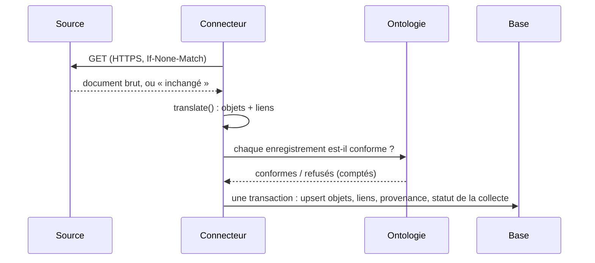

# Architecture

## Les services

| Service | Rôle | Réseaux | Utilisateur |
|---|---|---|---|
| `secrets` | crée les mots de passe de la base au premier lancement, puis s'arrête | aucun | 10001 |
| `db` | PostgreSQL 18 + PostGIS | `data` | 999 (postgres) |
| `migrate` | applique les migrations, crée les rôles restreints, puis s'arrête | `data` | 10001 |
| `collector` | lance les connecteurs selon leur cadence | `data`, `collect` | 10001 |
| `proxy` | seule sortie vers Internet : HTTPS vers les hôtes déclarés | `collect`, `egress` | 13 (proxy) |
| `api` | API FastAPI en lecture seule | `data`, `app` | 10001 |
| `web` | nginx : sert l'interface, relaie `/api/` vers `api` | `app`, `front` | 100 (nginx) |

`data`, `app` et `collect` sont des réseaux internes : aucune route vers Internet. Seul `web`
publie un port, sur `127.0.0.1:8080`. `secrets`, `migrate`, `collector` et `api` partagent la
même image : seule la commande change.

Ordre de démarrage : `secrets` → `db` → `migrate` → `api` et `collector` → `web`.

## Le trajet d'une donnée

1. **Récupération** — `HttpClient` refuse tout ce qui n'est pas HTTPS vers un domaine du
   manifeste, ne suit pas les redirections et borne la taille de la réponse.
2. **Traduction** — `translate()` est une fonction pure : elle ne touche ni le réseau ni la
   base. On la teste sur un extrait enregistré.
3. **Validation** — tout objet ou lien non conforme à l'ontologie est écarté et compté dans
   `skipped_count`.
4. **Chargement** — idempotent. Les données et le statut « réussi » sont écrits dans la même
   transaction : une collecte qui échoue ne laisse rien à moitié chargé.

Si le contenu est identique à la collecte précédente (même empreinte SHA-256, ou réponse
`304`), rien n'est réécrit : la collecte est notée « inchangée ».

## Le modèle de données

Cinq tables, quelle que soit la richesse de l'ontologie :

| Table | Contient |
|---|---|
| `sources` | une ligne par source : adresse, licence, attribution, droit de redistribution |
| `runs` | une ligne par collecte : statut, compteurs, empreinte du contenu, erreur éventuelle |
| `objects` | tous les objets : `type`, `key`, `title`, `properties` (JSONB), `geom` (PostGIS) |
| `links` | tous les liens : `type`, source, cible, `nature` (`fact` ou `hypothesis`) |
| `provenance` | quelle source a fourni quels champs de quel objet ou lien, et quand |

Un objet est unique par (`type`, `key`). Quand deux sources décrivent le même objet, leurs
propriétés sont fusionnées et chacune garde sa ligne de provenance.

Ajouter un type d'objet ne demande **aucune migration** : on le déclare dans `ontology.yaml`.

## L'API

Toutes les routes sont en `GET`. Schéma OpenAPI : `/api/openapi.json`.

| Route | Réponse |
|---|---|
| `/api/health` | état du service |
| `/api/ontology` | l'ontologie, telle que l'interface la consomme |
| `/api/stats` | nombre d'objets par type, nombre de liens |
| `/api/objects?type=…` | liste paginée ; `q`, `filter=prop:valeur`, `sort`, `order`, `page`, `size` |
| `/api/objects/{type}/{key}` | un objet et sa provenance |
| `/api/objects/{type}/{key}/neighbors` | ses voisins, dans les deux sens |
| `/api/sources`, `/api/runs` | état des sources et historique des collectes |

Le tri et les filtres sont vérifiés contre l'ontologie avant d'atteindre la base ; toutes les
valeurs sont des paramètres liés.

## Sécurité

Cloisonnement, proxy, privilèges, rôles de base, secrets, modèle de menaces et limites
assumées : voir [`security.md`](security.md).
