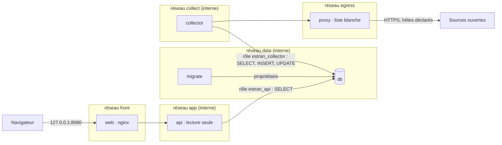

# Sécurité

Ce document dit ce qu'Estran protège, contre quoi, comment — et ce qui n'est **pas** couvert.
Chaque mesure annoncée ici est vérifiée par un script que l'on peut relancer :

```bash
docker compose up -d --build
bash scripts/check-hardening.sh   # 66 vérifications sur la pile en marche
bash scripts/security-scan.sh     # secrets, configuration, dépendances, images, inventaire
```

## Ce qu'on protège

| Bien | Pourquoi il compte |
|---|---|
| La machine hôte | Estran tourne sur un poste personnel : un conteneur compromis ne doit pas en sortir |
| L'intégrité des données | Une ontologie falsifiée (fausse provenance, fausse licence) trompe l'analyste |
| La sortie vers Internet | Un composant compromis ne doit pouvoir ni exfiltrer, ni attaquer un tiers |
| Les mots de passe de la base | Ils donnent accès à tout le reste |

Estran ne contient **aucune donnée personnelle ni confidentielle** : tout vient de sources
publiques. La confidentialité des données collectées n'est donc pas un enjeu ; leur intégrité, si.

## D'où peut venir une attaque

| Source | Exemple | Confiance |
|---|---|---|
| Une source de données | Flux compromis, réponse piégée, document géant | **Aucune** : tout ce qui est collecté est traité comme hostile |
| Le navigateur | Page malveillante ouverte à côté, qui vise `127.0.0.1:8080` | Aucune |
| Une dépendance | Paquet Python, npm ou image de base vulnérable | Limitée, surveillée |
| Un autre programme du poste | Peut joindre `127.0.0.1:8080` comme le navigateur | Aucune |

Hors périmètre : un attaquant déjà administrateur du poste, ou ayant accès au démon Docker
(il a alors tous les droits, par construction de Docker).

## Les frontières



Un réseau « interne » n'a aucune route vers Internet. Un service ne voit que les voisins
dessinés ici : `web` ne voit ni la base ni le proxy, `api` ne voit pas le proxy.

## Menaces et réponses (STRIDE)

| Menace | Scénario | Réponse | Vérifié par |
|---|---|---|---|
| **Usurpation** | Un conteneur se fait passer pour l'API auprès de la base | Un rôle et un mot de passe par service, générés au premier lancement ; chaque conteneur ne monte que le sien | `check-hardening` §5, tests `test_roles.py` |
| **Falsification** | L'API, compromise, modifie les données | Son rôle n'a que `SELECT` : la base refuse, même si le code est détourné | `check-hardening` §5 |
| **Falsification** | Le collecteur, compromis, efface l'historique | Son rôle n'a ni `DELETE`, ni `TRUNCATE`, ni droit sur le schéma | `check-hardening` §5 |
| **Falsification** | Une source renvoie un document hors ontologie | Validation avant écriture ; ce qui ne correspond pas est refusé et compté | tests `test_runner.py` |
| **Falsification** | Injection SQL par un tri, un filtre ou une recherche | Valeurs toujours liées ; tri et filtres vérifiés contre l'ontologie ; `%` et `_` neutralisés | tests `test_api.py`, `check-hardening` §6 |
| **Répudiation** | « Cette donnée ne vient pas de chez nous » | Chaque objet garde sa source, sa licence et sa date ; chaque collecte garde l'empreinte SHA-256 du contenu reçu | tests `test_runner.py` |
| **Divulgation** | Un mot de passe traîne dans le dépôt ou l'environnement | Aucun mot de passe dans le dépôt, ni dans `compose.yaml`, ni en variable d'environnement : fichiers en lecture seule dans un volume | `check-hardening` §5, `gitleaks` |
| **Divulgation** | Exfiltration depuis un conteneur compromis | `api` et `db` n'ont aucune route de sortie ; `collector` ne sort que par le proxy, vers les hôtes déclarés, en HTTPS | `check-hardening` §2 et §3 |
| **Déni de service** | Une source envoie quelques Ko qui se décompressent en Go | Décompression pas à pas, arrêtée dès la limite ; taille bornée ; pas de redirection suivie | tests `test_http_client.py` |
| **Déni de service** | Rafale de requêtes sur l'API | 20 requêtes/s par adresse puis erreur 429 ; pagination plafonnée ; mémoire et nombre de processus limités par conteneur | `check-hardening` §6 |
| **Élévation** | Sortir d'un conteneur vers l'hôte | Aucun conteneur en root, aucune capacité Linux, `no-new-privileges`, système de fichiers en lecture seule | `check-hardening` §4 |
| **Élévation** | Contenu collecté exécuté dans le navigateur (XSS) | React échappe tout texte ; aucun HTML collecté n'est interprété ; politique CSP sans script ni style en ligne | `check-hardening` §6 |
| **Chaîne d'approvisionnement** | Dépendance ou image vulnérable | Versions verrouillées (`uv.lock`, `package-lock.json`) ; scan à chaque commit et chaque lundi ; correctifs système appliqués au build ; `pip`, `uv` et `gosu` retirés des images | `security-scan` |

## Le proxy sortant

`collector` n'a aucune route directe vers Internet. Il passe par Squid, qui n'accepte que :

- des tunnels **HTTPS** (`CONNECT` sur le port 443) — pas de HTTP en clair ;
- vers un **hôte de la liste blanche**, au nom exact — ni sous-domaine, ni adresse IP.

La liste blanche (`infra/proxy/allowlist.txt`) est **générée depuis les manifestes des
connecteurs**. Un test échoue si le fichier ne correspond plus aux manifestes : ajouter un
domaine laisse donc forcément une trace relue dans le dépôt. Le journal du proxy ne contient
que des tentatives de sortie, acceptées (`TCP_TUNNEL`) ou refusées (`TCP_DENIED`) :

```bash
docker compose logs proxy
```

Le client HTTP du collecteur applique la même règle côté application : deux barrières
indépendantes pour la même garantie. Il ne suit une redirection que vers un hôte déclaré, en
HTTPS, et trois fois au plus.

Hôtes ouverts à ce jour : `www.cisa.gov`, `services.nvd.nist.gov`,
`epss.empiricalsecurity.com`, `www.cert.cyber.gouv.fr` et `raw.githubusercontent.com`.
Ce dernier est **large** : il sert le contenu de tous les dépôts publics de GitHub, pas
seulement ceux de MITRE. Le proxy ne voyant que le nom d'hôte, un collecteur compromis
pourrait y lire n'importe quel fichier public (mais pas y écrire).

## Les mots de passe

Au premier lancement, le service `secrets` crée trois mots de passe aléatoires (256 bits)
dans un volume Docker, un par rôle de base. Ils ne sont jamais affichés ni journalisés.
Chaque fichier est créé directement avec ses droits définitifs (`440`) : lisible par son
propriétaire et un groupe, jamais par « tous ». La base, qui tourne sous un autre utilisateur,
y accède par ce groupe.

| Qui | Ce qu'il monte | Rôle dans la base |
|---|---|---|
| `db` | le mot de passe propriétaire | — |
| `migrate` | les trois (il crée les rôles) | propriétaire, le temps de la migration |
| `collector` | le sien | `estran_collector` : lit, insère, met à jour |
| `api` | le sien | `estran_api` : lit |

Changer les mots de passe des rôles `estran_collector` et `estran_api` (procédure testée) :

```bash
docker compose run --rm --no-deps --entrypoint sh secrets -c \
  'rm /run/estran-secrets/api/password /run/estran-secrets/collector/password'
docker compose down
docker compose up -d   # « secrets » recrée les deux fichiers, « migrate » réaligne la base
```

## Ce qui n'est pas couvert

À connaître avant de faire confiance à ce durcissement :

- **`web` peut sortir vers Internet sous Docker Desktop.** Docker exige un réseau non interne
  pour publier un port. Le réglage qui coupe cette sortie est posé dans `compose.yaml`, mais
  il est **sans effet constaté sous Docker Desktop** (vérifié : la sortie fonctionne) et n'a
  pas été testé sur un Docker Linux natif. Atténuation : nginx n'émet aucune requête de
  lui-même, tourne sans privilèges et en lecture seule.
- **Pas de TLS en local.** Le trafic entre le navigateur et `127.0.0.1:8080` est en clair,
  comme entre les conteneurs. Acceptable sur une seule machine ; à revoir avant toute
  exposition sur un réseau.
- **Pas d'authentification.** Tout programme du poste peut lire l'API. Les données étant
  publiques, c'est un choix ; il devra changer avec la phase « Mon parc » (inventaire privé).
- **Le mot de passe propriétaire ne tourne pas tout seul** : il est fixé à la création de la base.
- **Le nom d'hôte, pas le contenu.** Le proxy ne déchiffre pas les tunnels : il garantit vers
  qui l'on sort, pas ce qu'on y envoie.
- **Vulnérabilités sans correctif.** Le scan bloque sur les failles critiques ou élevées
  *disposant d'un correctif* ; les autres sont visibles dans le rapport mais ne bloquent pas.
- **Images épinglées par étiquette**, pas par empreinte : une image de base republiée sous la
  même étiquette serait acceptée.
- **La CI n'a jamais tourné** : le dépôt n'a pas encore été poussé sur GitHub. Les scripts
  qu'elle appelle, eux, ont été exécutés sur ce poste.

## Signaler un problème

Ouvrir un ticket sur le dépôt, sans détail exploitable dans le titre.
